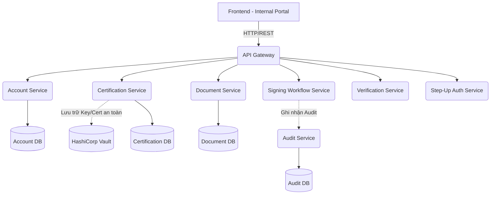

# PKI System (Public Key Infrastructure)

Dự án PKI System là một nền tảng quản lý chứng thư số và chữ ký điện tử, được thiết kế theo kiến trúc Microservices chuyên sâu. Hệ thống phục vụ việc quản lý vòng đời chứng thư, xác thực chữ ký, lưu trữ tài liệu an toàn và hỗ trợ xác thực nâng cao (MFA/OTP).

## Kiến trúc hệ thống (Architecture)

Hệ thống được thiết kế phân tán với API Gateway làm điểm chạm duy nhất, kết hợp với HashiCorp Vault để quản lý khóa và bảo mật token.



## Các Microservices chính

Hệ thống bao gồm các dịch vụ Backend (Spring Boot) độc lập:
1. **API Gateway:** Định tuyến request, kiểm tra xác thực bước đầu.
2. **Account Service:** Quản lý tài khoản, phân quyền người dùng.
3. **Certification Service:** Quản lý vòng đời chứng thư số (Cấp phát, gia hạn, thu hồi), tích hợp trực tiếp với HashiCorp Vault.
4. **Signing Workflow Service:** Điều phối quy trình và luồng ký duyệt tài liệu.
5. **Document Service:** Quản lý tài liệu điện tử trước và sau khi ký.
6. **Verification Service:** Dịch vụ kiểm tra và xác thực chữ ký số.
7. **Step-Up Auth Service:** Xác thực tăng cường (OTP, MFA) cho các nghiệp vụ quan trọng.
8. **Audit Service:** Lưu vết (log) mọi thao tác trên hệ thống để phục vụ đối soát.

## Cấu trúc thư mục (Folder Structure)

```text
PKI-System/
├── docs/                       # Tài liệu thiết kế hệ thống
│   ├── erd-sql/                # Scripts SQL khởi tạo database (Account, Audit,...)
│   └── ...                     # Sơ đồ và luồng hệ thống
├── frontend/                   # Giao diện người dùng
│   └── internal-portal/        # Cổng thông tin nội bộ (ReactJS / Vite / Zustand)
│       ├── src/
│       └── package.json
└── services/                   # Các Microservices Backend (Java/Spring Boot)
    ├── api-gateway/
    ├── account-service/
    ├── certification-service/  # Cấu hình kết nối HashiCorp Vault
    └── ...
```

## Ngôn ngữ & Công cụ (Tech Stack)

* **Frontend:** ReactJS, Vite, Zustand, Tailwind CSS.
* **Backend:** Java, Spring Boot, Spring Cloud.
* **Bảo mật & Lưu trữ Khóa:** HashiCorp Vault.
* **Database:** SQL (Mỗi service sở hữu một DB riêng theo chuẩn Microservices).

## Hướng dẫn cài đặt (Getting Started)

### 1. Khởi tạo Cơ sở dữ liệu (Database)
Thiết lập các database riêng biệt cho từng service bằng cách chạy các file script SQL nằm trong thư mục `docs/erd-sql/` (ví dụ: `account_db.sql`, `certification_db.sql`...).

### 2. Thiết lập HashiCorp Vault
* Cài đặt và khởi chạy Vault server.
* Tạo các policy và secret engine cần thiết cho PKI.
* Lấy `Root Token` và cập nhật vào file `application.yml` của `certification-service` (Lưu ý: Không commit token thật lên Git).

### 3. Khởi chạy Backend (Microservices)
Vào từng thư mục service trong `services/` (bắt đầu từ các service lõi và kết thúc bằng API Gateway):
```bash
cd services/tên-service
# Cấu hình application.yml (Database url, Vault token...)
# Build và chạy ứng dụng (ví dụ với Maven)
./mvnw spring-boot:run
```

### 4. Khởi chạy Frontend (Internal Portal)
```bash
cd frontend/internal-portal
npm install

# Copy file biến môi trường và điều chỉnh URL API Gateway
cp .env.example .env

# Khởi chạy môi trường phát triển
npm run dev
```
Truy cập ứng dụng tại `http://localhost:5173` (hoặc cổng cấu hình của Vite).

## Lưu ý Bảo mật (Security Notes)
Dự án này tuân thủ các quy tắc bảo mật không lưu trữ thông tin nhạy cảm trên mã nguồn mở. Hãy đảm bảo bạn đã:
* Cấu hình `.gitignore` để bỏ qua các file `.env` của Frontend.
* Không commit trực tiếp `Vault Root Token`, DB Password, hoặc Private Keys trong các file `application.yml` của Backend.
* Sử dụng biến môi trường (Environment Variables) cho các thông tin bảo mật khi triển khai (Deploy).
