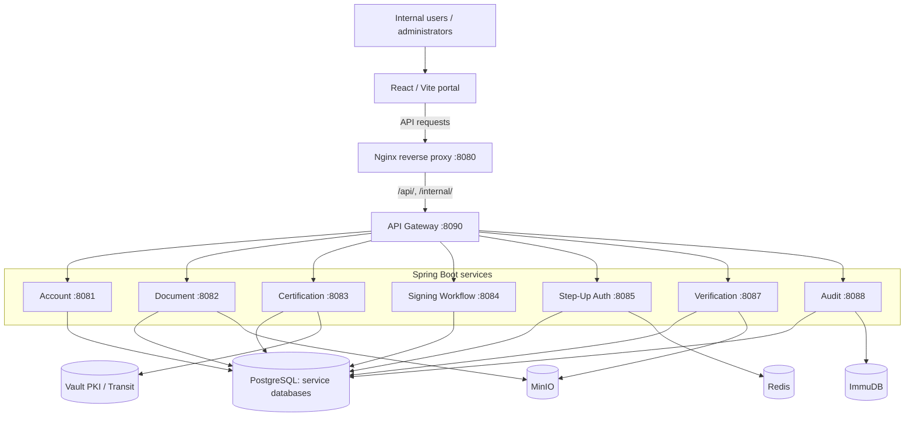

# PKI System — Internal Certificate Management & Digital Signing

An internal **Public Key Infrastructure (PKI) and digital-signing platform** developed as a microservices project. It connects certificate lifecycle management, document storage, multi-party signing workflows, WebAuthn step-up authentication, signature verification, and audit events through a React-based portal.

> **Project scope:** This repository documents a development/lab implementation, **not a production-ready CA or a certified/compliance-assessed signature service**. Several flows need further validation or hardening. No claim is made that a fresh clone will reproduce the previous runtime state. See [known limitations](#scope-and-known-limitations) and [security cautions](#security-and-publication-cautions).

## At a glance

| Area | Implementation represented in the repository |
| --- | --- |
| Frontend | React, TypeScript, Vite, React Router, TanStack Query, Zustand |
| Backend | 8 Java / Spring Boot microservices, including API Gateway |
| Infrastructure | Nginx, PostgreSQL, Redis, MinIO, HashiCorp Vault, ImmuDB |
| Certificate management | Internal X.509 certificate requests, issuance, renewal and revocation |
| Document signing | Signing requests, PDF signed output (PAdES-style detached signature), non-PDF CMS/CAdES `.p7m` output |
| Strong authentication | WebAuthn step-up with enrollment and recovery-related flows |
| Verification & audit | Internal-CA verification and partial external-CA path; audit persistence/indexing |

## System architecture



This is a **logical component diagram**, not a full service-to-service call graph. Most services run as host processes in the provided Windows development scripts; Docker Compose supplies the backing infrastructure. The Nginx configuration routes requests to the locally running gateway. See the [detailed overview](docs/architecture/system-overview.md) and [security architecture](docs/architecture/security-architecture.md).

## Backend services

| Service | Responsibility | Directory |
| --- | --- | --- |
| API Gateway | HTTP request routing to backend services | [`api-gateway`](services/api-gateway/) |
| Account | Registration, authentication, account status and role management | [`account-service`](services/account-service/) |
| Certification | Certificate lifecycle and Vault-backed signing integration | [`certification-service`](services/certification-service/) |
| Document | Document metadata, versions, uploads and object storage | [`document-service`](services/document-service/) |
| Signing Workflow | Signing requests, approvals and signed artifact generation | [`signing-workflow-service`](services/signing-workflow-service/) |
| Step-Up Auth | WebAuthn enrollment, challenges, proof and recovery-related endpoints | [`step-up-auth-service`](services/step-up-auth-service/) |
| Verification | Signature verification and verification reports | [`verification-service`](services/verification-service/) |
| Audit | Security/audit event ingestion and retrieval | [`audit-service`](services/audit-service/) |

## Security architecture

The security-related implementations below already exist in the project; descriptions refer to the **code/design**, not to independent proof of end-to-end security:

- **PKI and cryptographic signing:** internal certificate management backed by Vault PKI and Vault Transit. The certificate service checks signing-certificate validity and signs through the Transit integration, rather than extracting a private key for application-side signing. [Source: certificate signing service](services/certification-service/src/main/java/com/ct556/certification_service/service/InternalCertificateSigningService.java) and [Transit signer](services/certification-service/src/main/java/com/ct556/certification_service/vault/VaultTransitContentSigner.java).
- **Signed artifacts:** a PDF signing path embeds a detached signature and can place a visible signature appearance; non-PDF artifacts use CMS `.p7m`. [Source: signed-output service](services/signing-workflow-service/src/main/java/com/ct556/signing_workflow_service/service/EmbeddedSignatureOutputService.java).
- **WebAuthn step-up:** sensitive actions can require a challenge/proof; enrollment and recovery controllers exist. See [WebAuthn service](services/step-up-auth-service/src/main/java/com/ct556/step_up_auth_service/service/WebAuthnStepUpService.java) and [recovery controller](services/step-up-auth-service/src/main/java/com/ct556/step_up_auth_service/controller/WebAuthnRecoveryController.java).
- **Verification:** parses signed output, evaluates signatures/certificates, and records reports. The external-CA and long-term validation paths have documented limitations. [Source: verification service](services/verification-service/src/main/java/com/ct556/verification_service/service/VerificationService.java).
- **Audit:** events are tracked through the audit service, including integration with ImmuDB. [Source: ImmuDB store](services/audit-service/src/main/java/com/ct556/audit_service/service/ImmudbAuditStore.java).
- **Access control:** administrative and user roles, account status checks and frontend route guards; backend authorization must be reviewed separately from UI guards.

See [security architecture & trust boundaries](docs/architecture/security-architecture.md) and [existing business workflows](docs/architecture/core-workflows.md).

## Repository structure

```text
PKI-System/
├── README.md
├── .gitignore
├── docs/
│   ├── architecture/           # Architecture, security boundaries and workflows
│   ├── reference/              # Existing API / UI docs and ERD SQL references
│   └── project-status/         # Historical progress, implementation plan and gaps
├── frontend/internal-portal/   # React client
├── services/                   # Eight Spring Boot projects
├── infra/                      # Docker Compose, Nginx, PostgreSQL init, Vault config
└── scripts/                    # Existing Windows PowerShell development scripts
```

## Development environment (reference only)

The source reflects a **local Windows/PowerShell + Docker development environment**. These are pointers to the existing setup, not a freshly validated deployment recipe.

**Infrastructure:** [`infra/docker-compose.yml`](infra/docker-compose.yml) configures PostgreSQL, Redis, MinIO, Vault, ImmuDB, and Nginx. The PostgreSQL init script creates seven databases at **first initialization** (`infra/postgres/init/01-init-multiple-dbs.sql`). Schema migrations are in each Spring Boot service's `src/main/resources/db/migration/` directory (Flyway); files under [`docs/reference/erd-sql/`](docs/reference/erd-sql/) are **design/reference SQL**, not the authoritative deployment order.

Existing PowerShell scripts from repository root:

```powershell
# In a Windows PowerShell session with Docker, Java and Maven wrapper prerequisites
.\scripts\Start-Dev.ps1 -WithInfra
.\scripts\Status-Dev.ps1
.\scripts\Stop-Dev.ps1
```

The frontend uses the supplied example environment file:

```powershell
cd frontend/internal-portal
Copy-Item .env.example .env
npm install
npm run dev
```

The existing Vite frontend uses `http://localhost:5173` by default and `.env.example` points API requests at Nginx `http://localhost:8080`. Consult each existing configuration and the [frontend README](frontend/internal-portal/README.md) before running. **Vault must be initialized/unsealed and configured separately**, and some local configuration values will require review. The runtime Vault state, logs and local secrets from prior machines are intentionally **not** included in this publication copy.

## Documentation

- [System overview](docs/architecture/system-overview.md)
- [Security design and trust boundaries](docs/architecture/security-architecture.md)
- [Core workflows](docs/architecture/core-workflows.md)
- [Frontend architecture](docs/architecture/frontend-architecture.md)
- [Backend API map](docs/reference/backend-api-map.md)
- [Frontend routes](docs/reference/frontend-routes.md) / [pages](docs/reference/frontend-pages.md)
- [Database reference SQL](docs/reference/erd-sql/)
- [Gap analysis](docs/project-status/gap-analysis.md)
- [Historical implementation notes](docs/project-status/implementation-plan.md) / [progress log](docs/project-status/progress.md)

## Scope and known limitations

- The project is not a public CA or production PKI deployment, and features have not been independently security audited.
- External-CA verification is **partial**. External trusted timestamping, long-term validation (LTV/LT/LTA) and complete offline revocation evidence are not established in the repository.
- WebAuthn has enrollment/recovery code; the gap analysis records unresolved session revocation, cooldown and lost-session helpdesk scenarios. Browser/device runtime retesting remains necessary.
- Some UI/summary endpoints, sensitive-action confirmation UX, pagination and responsive details remain incomplete.
- Source code and configuration were preserved for this documentation-only update; functional tests and full deployment were **not** rerun as part of this revision.

See [the existing gap analysis](docs/project-status/gap-analysis.md) for more details. Some historical planning documents predate later code changes and should not be interpreted as final implementation claims.

## Security and publication cautions

**Do not publish this repository as-is without checking and rotating credentials**. The existing source contains hardcoded development values (including a shared JWT signing secret and service/database/object-storage credentials), and the Vault configuration uses HTTP without TLS for local development. The documentation-only reorganization **does not modify runtime configuration**, by design. If any of these credentials were ever used outside a disposable local environment, consider them exposed and rotate them before publishing. Do not reuse development defaults in a deployed system.

`.gitignore` excludes local Vault storage (`infra/vault/data/`), logs, runtime files, `.env` files and private-key formats. This only prevents **new Git tracking**; it cannot remove sensitive data from existing Git history. If these files were already committed, clean the remote history and rotate affected secrets before publishing. Retain a separate private backup of any local state needed for running the previous environment.

---

*Repository presentation update: documentation and file organization only; no application features or runtime components were added.*
