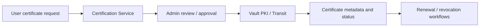
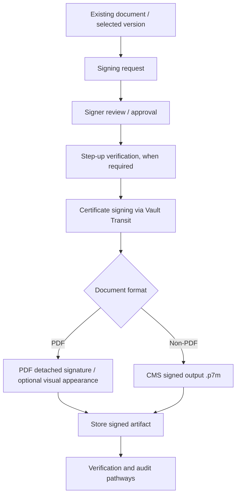
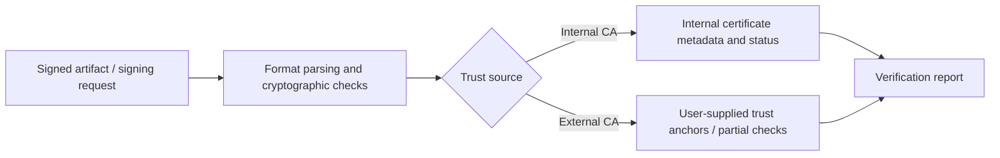

# Existing Core Workflows

These diagrams summarize **repository-supported logic**, not a completed runtime integration test. Arrows show conceptual stages; not every arrow maps to one synchronous HTTP call. Refer to service implementations for exact routes and request bodies.

## 1. Certificate lifecycle

Existing code is organized under [`services/certification-service/`](../../services/certification-service/). Read its controllers and services for precise approval, issue, renewal and revoke transitions.

## 2. Document signing

This represents the linked domain responsibilities of [`signing-workflow-service`](../../services/signing-workflow-service/), [`step-up-auth-service`](../../services/step-up-auth-service/), [`certification-service`](../../services/certification-service/) and [`document-service`](../../services/document-service/). The final verification step is an **available downstream workflow**, not a guarantee that verification runs automatically for each signature.

## 3. Signature verification

External CA trust validation, timestamps, and long-term revocation evidence are **not feature-complete**. Refer to [`VerificationService.java`](../../services/verification-service/src/main/java/com/ct556/verification_service/service/VerificationService.java) and [gap analysis](../project-status/gap-analysis.md).

## 4. Step-up and recovery (high-level)

A user may enroll an authenticator (subject to the existing first-enrollment ticket rules), obtain a WebAuthn challenge for sensitive actions, and submit an assertion. Existing recovery endpoints enable administrator-assisted recovery paths, but lost-session escalation and post-change session invalidation remain documented gaps.

Code links: [`WebAuthnStepUpService.java`](../../services/step-up-auth-service/src/main/java/com/ct556/step_up_auth_service/service/WebAuthnStepUpService.java) · [`WebAuthnRecoveryController.java`](../../services/step-up-auth-service/src/main/java/com/ct556/step_up_auth_service/controller/WebAuthnRecoveryController.java).
