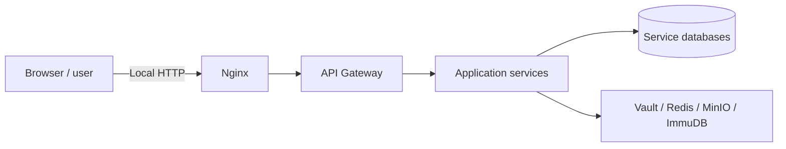

# Security Architecture and Trust Boundaries

This document describes the **existing design and implementation**, without treating the presence of a library or an endpoint as proof of successful end-to-end security validation.

## 1. Request and identity boundaries

- The frontend exposes public, authenticated, active-account and role-based routes (`frontend/internal-portal/src/routes/guards/`). Those are **presentation controls**, not a substitute for server-side authorization.
- Account service provides authentication/account metadata. Multiple services validate JWT material. The source uses a shared signing secret in local configuration; this is a **security exposure if published or deployed without secret management**.
- The API Gateway defines route mapping; do **not** assume route dispatch itself is sufficient authorization or token enforcement without verifying each backend endpoint.
- The Nginx and Vault example configurations use local HTTP. TLS termination, production network isolation and actual enforcement were not validated in this documentation change.

## 2. PKI and signing key boundary

Certificate management is implemented by `certification-service`, integrated with HashiCorp Vault PKI and Transit. In the internal signing path, `InternalCertificateSigningService` looks up the certificate metadata, checks the certificate is not revoked or outside its time window, and delegates signing to `VaultPkiClient.signWithTransitKey`.

Relevant code:

- [`InternalCertificateSigningService.java`](../../services/certification-service/src/main/java/com/ct556/certification_service/service/InternalCertificateSigningService.java)
- [`VaultTransitContentSigner.java`](../../services/certification-service/src/main/java/com/ct556/certification_service/vault/VaultTransitContentSigner.java)
- [`VaultPkiClient.java`](../../services/certification-service/src/main/java/com/ct556/certification_service/vault/VaultPkiClient.java)

**Boundary:** business services handle certificate references and sign requests, while Vault controls cryptographic key operations according to its runtime configuration. Vault data under `infra/vault/data/` is stateful/sensitive and is not part of the public repository copy.

## 3. Signature and document boundary

`signing-workflow-service` coordinates requests and creates outputs in `EmbeddedSignatureOutputService`:

- PDF: detached signature embedded into the PDF with PDFBox/BouncyCastle; optional visual signature appearance.
- Other supported content: CMS signed artifact with `.p7m` representation.
- The document/storage path uses MinIO; certificates/signing requests are recorded separately in their services.
- Source also includes internal timestamp integration; do not equate this with full, external, long-term-qualified timestamp validation.

See [core workflows](core-workflows.md) and the [output implementation](../../services/signing-workflow-service/src/main/java/com/ct556/signing_workflow_service/service/EmbeddedSignatureOutputService.java).

## 4. Step-up authentication boundary

`step-up-auth-service` provides WebAuthn challenge/enrollment/assertion flows. The existing code and historical gap analysis describe a first-enrollment ticket issued by an admin, an active-authenticator restriction and a recovery-request path. The design uses Redis for short-lived challenge/proof state.

Relevant code: [`WebAuthnStepUpService`](../../services/step-up-auth-service/src/main/java/com/ct556/step_up_auth_service/service/WebAuthnStepUpService.java), [`WebAuthnRecoveryController`](../../services/step-up-auth-service/src/main/java/com/ct556/step_up_auth_service/controller/WebAuthnRecoveryController.java).

**Recorded limitations:** session revocation after sensitive security changes, a post-reset signing cooldown and recovery after loss of both the authenticator and an active session are not established as completed. See [gap analysis](../project-status/gap-analysis.md).

## 5. Verification boundary

`verification-service` parses signed outputs and performs certificate and signature checks with report generation. The existing design supports internal CA verification and an `EXTERNAL_CA` route using supplied trust anchors with a best-effort revocation mechanism. External timestamp validation, complete long-term validation and detailed external-CA reporting are out of scope for the existing implementation.

[Verification source](../../services/verification-service/src/main/java/com/ct556/verification_service/service/VerificationService.java) · [Gaps](../project-status/gap-analysis.md)

## 6. Audit boundary

The `audit-service` receives events and records audit data (including ImmuDB-backed storage in `ImmudbAuditStore`). An append-oriented database alone is **not** a demonstrated tamper-proof security property without reviewing the full access model, integrity verification, and operational controls.

[Audit source](../../services/audit-service/src/main/java/com/ct556/audit_service/service/ImmudbAuditStore.java)

## 7. Security limitations of the supplied development configuration

- Shared JWT secret embedded in multiple `application.yml` files.
- Default/local database, MinIO and ImmuDB credentials in service and Compose configuration.
- Vault root token placeholder plus local HTTP/no TLS in Vault config.
- Gateway CORS policy is permissive in the local configuration.
- Logs and Vault runtime state were present in the original archive; intentionally excluded from the publication copy.

These are **documented review findings**, not fixes. The application and configuration were not changed. Rotate previously exposed values and separately harden deployment configuration before making any production claim.
